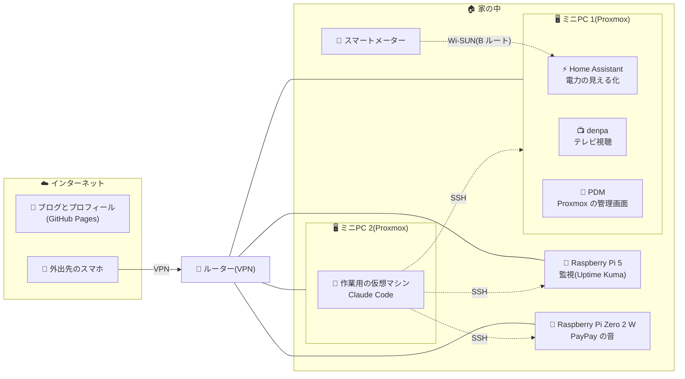
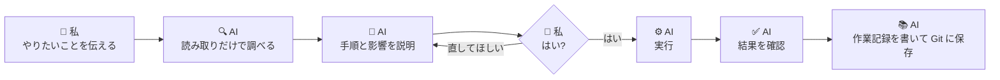
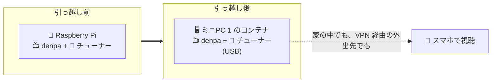
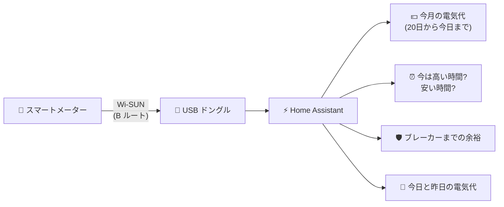
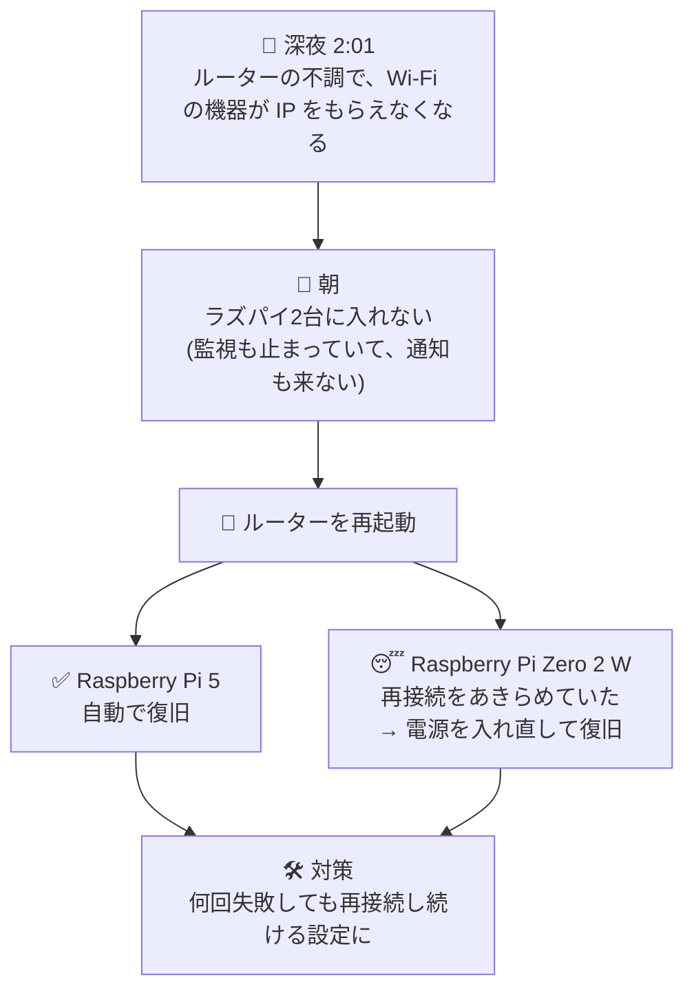

> **この記事について:** この記事は、AI(Anthropic の Claude)が作業記録をもとに下書きを書き、私が内容を確認して公開しています。記事の中で紹介している作業も、AI エージェントの Claude Code を使って行いました。

最近の趣味はバイブコーディングです。
今回は、家にある自宅サーバーを AI エージェントの Claude Code と一緒に整理しました。
コマンドを打つのはほとんど AI に任せて、私は「何をしたいか」を伝えて、確認して「はい」と答える役です。

この記事では、2日間でやったことをまとめます。

## 家の構成

| 機器 | 役割 |
|---|---|
| ミニPC 2台(Proxmox VE) | 仮想マシンとコンテナの置き場 |
| Raspberry Pi 5 | 監視 |
| Raspberry Pi Zero 2 W | IC カードをかざすと音が鳴る、ちょっとしたおもちゃ |
| 作業用の仮想マシン | Claude Code が動く場所。ここから各サーバーに SSH で入る |

Proxmox はクラスターを組まず、2台を別々に動かしています。

## 最初に決めたルール

AI にサーバーを触らせるので、最初に作業ルールを `CLAUDE.md` にまとめました。

- 削除、再起動、ネットワークの変更などは、内容を説明してもらい、私が「はい」と答えてから実行する
- 状態の確認や設定ファイルの読み取りは、確認なしでよい
- 変更する前に、設定ファイルのバックアップを取る
- パスワードやトークンは、ファイルや Git に書かない
- 作業が終わったら、作業記録に追記する

実際に使ってみると、このルールがよく効きました。
「消してよいですか?」と毎回聞かれるので安心ですし、AI が自分のミスに気づいたときも正直に報告してくれます。

## やったこと

### 1. 2台の Proxmox を1画面で見られるようにした

Proxmox Datacenter Manager(PDM)をコンテナに入れて、2台の Proxmox を1つの画面で見られるようにしました。

公式の手順どおりに入れたつもりが、推奨パッケージの関係で、コンテナには不要なカーネルや ZFS まで一緒に入ってしまいました。
これは AI が気づいて報告してくれたので、削除する一覧を確認してから片付けました。

### 2. 設定を Git で管理するようにした

作業ルールや作業記録、各サーバーの設定ファイルを、GitHub の非公開リポジトリで管理するようにしました。
バックアップは当面しない方針なので、「設定は Git に残す」が大事な支えになっています。

途中で、以前このブログのリポジトリに、自分のメールアドレスが入ったコミットが公開されていたことに気づきました。
履歴を書き換えて消し、GitHub の設定でメールアドレスを非公開にしました。

### 3. このブログとプロフィールページを整えた

このブログ(Hugo、GitHub Pages)は、ビルドに使う Hugo のバージョンが「最新」のままでした。
試しに最新版でビルドすると、テーマが対応しておらず失敗することが分かったので、バージョンを固定しました。

あわせて、[kayabon.net](https://kayabon.net) にプロフィールページを作りました。
GitHub のプロフィール README を、そのまま GitHub Pages で公開しています。
証明書がなかなか発行されず、カスタムドメインを入れ直したら発行された、というのが小さなつまずきでした。

### 4. テレビ視聴サーバーをラズパイから Proxmox に引っ越した

テレビを観るためのソフト(denpa)を、ラズパイから Proxmox のコンテナに引っ越しました。
チューナーは USB でつなぐタイプなので、コンテナに USB を渡す設定が必要でした。

つまずいた点が2つありました。

- 動いていたのと同じ版のイメージが、もう配布されていなかったので、新しい版に上げることになった
- 非特権のコンテナでチューナーが動くかは、挿してみるまで分からなかった(結果は動いた)

録画はせず、外出先から VPN 経由で観る使い方です。
家の中と、スマホのモバイル回線からの両方で観られることを確かめてから、ラズパイ側を片付けました。

### 5. IP の割り当てをルーターの予約にまとめた

これまでは機器ごとに IP を固定で設定していましたが、ルーターのアドレス予約にまとめました。
Proxmox の2台だけは固定のまま予約も登録し、それ以外は DHCP にしています。

| | 前 | 後 |
|---|---|---|
| IP の決め方 | 機器ごとに固定の設定 | ルーターのアドレス予約で一元管理 |
| 新しい機器を足すとき | 機器の中で設定 | ルーターに予約を登録してから DHCP に |
| Proxmox の2台 | 固定 | 固定のまま(予約も登録) |

ここでは AI のミスもありました。
作業用の仮想マシンを DHCP に切り替えるスクリプトで、成功の判定に「IP に有効期限が付いていること」を使っていたのですが、予約で割り当てられる IP は期限なしでした。
そのため成功しているのに失敗と判定され、元の設定に自動で戻ってしまい、そのときに DNS の設定まで消えてしまいました。

2回目は、私が Proxmox のコンソールを開いた状態で手作業で切り替え、再起動しても IP、ゲートウェイ、DNS が正しく入ることを確かめました。
「ネットワークの変更は、コンソールを開いてから」は大事ですね。

### 6. スマートメーターの電力を見える化した(HEMS)

電力会社から B ルートのパスワードが届いたので、Home Assistant の仮想マシンを作り、Wi-SUN の USB ドングルでスマートメーターとつなぎました。
Home Assistant には B ルートの公式の連携機能があり、ドングルも動作確認済みのものだったので、すんなり値が取れました。

表示は、家族が見ても分かる言葉にこだわって作り直しました。

- 今月の電気代(締め日に合わせて、20日から今日まで)と、このままだと今月いくらになりそうか
- 今日と昨日の電気代
- 今は電気代が高い時間か安い時間か(時間帯で単価が変わるプランなので)
- ブレーカーまでの余裕(「R 相」「T 相」と言われても分からないので、% で表示)

燃料費調整額や再エネ賦課金は公開されている値なので、それを毎月入力すると、電気代の目安に反映されるようにしました。

### 7. 監視を入れた(Uptime Kuma)

空いていたラズパイに Uptime Kuma を入れて、各サーバーとサービスが応答するかを監視しています。
止まったら Gmail に通知が来ます。

### 8. ラズパイの「PayPay」を管理下に入れた

IC カードリーダーにかざすと、Bluetooth スピーカーから決済音が鳴るラズパイがあります。
これも作業用の仮想マシンから SSH で入れるようにして、プログラムを Git に保存し、監視の対象に加えました。

### 9. セキュリティ更新を自動にした

Debian の公式のセキュリティ更新だけを、毎日自動で入れるようにしました。
Proxmox 本体などの更新や、再起動は自動にせず、これまでどおり確認してから行います。

## 途中で起きたトラブル

### 夜中に Wi-Fi の機器がまとめて止まった

ある朝、Wi-Fi でつながっているラズパイ2台に入れなくなっていました。

ログを見ると、深夜2時ごろからルーター側の不調で、IP をもらえなくなっていたようです。
ルーターを再起動して1台は戻りましたが、もう1台は再接続をあきらめていて、電源の入れ直しが必要でした。

対策として、2台とも「何回失敗しても Wi-Fi に再接続し続ける」設定にしました。

監視用のラズパイ自身も止まっていたので、このあいだ通知も来ませんでした。
家ごと止まったときに気づける仕組みは、今後の課題です。

### 更新中にラズパイが応答しなくなった

セキュリティ更新を初めて入れたとき、メモリの少ない Raspberry Pi Zero 2 W が、途中から応答しなくなりました。
更新自体は最後まで終わっていましたが、ネットワークだけが戻らず、電源を入れ直しました。
ログが再起動後に残らない設定だったので原因は分からず、次に備えてログを残すようにしました。

## やってみて

- AI に任せる範囲と、自分で判断する範囲を最初に決めておくと、安心して任せられる
- 「消してよいですか?」「これは確認できていません」と、できたこととできていないことを分けて報告してくれるのがありがたい
- それでもミスはあるので、ネットワークの変更などは、戻せる手段(コンソールやスナップショット)を用意してから

家の中のことが少しずつ見えるようになってきたので、次は家族も使える形にしていきたいと思います。
